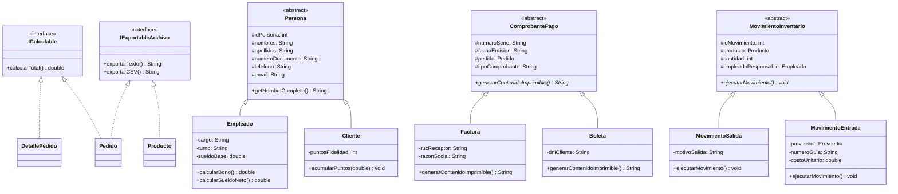

# ☕ Cafetería Aurora - Sistema de Gestión POO

> **Sistema de Punto de Venta (POS), Control de Inventario y Gestión Operativa**  
> Proyecto universitario desarrollado bajo el enfoque de **Programación Orientada a Objetos (POO)** en **Java 17** y **Swing**, con persistencia en **Microsoft SQL Server** y soporte offline mediante archivos planos.

---

## 📌 Descripción del Proyecto

**Cafetería Aurora** es una solución integral de software diseñada para optimizar los flujos operativos de una cafetería de especialidad. Proporciona dos entornos de trabajo diferenciados y desacoplados:

1. **Panel del Trabajador / Barista (Atención de Pedidos - POS):**
   - Catálogo interactivo de 22 productos clasificados en 4 categorías: *Bebidas Calientes*, *Bebidas Frías*, *Panadería* y *Postres*.
   - Carrito de compras con cálculo automático de subtotales, base imponible e IGV (18%).
   - **Validación estricta de DNI en tiempo real:** Restricción a exactamente 8 dígitos numéricos mediante `DocumentFilter` que impide caracteres alfabéticos o exceder el límite permitido.
   - Registro de datos del cliente (Nombre, Apellido, DNI) obligatorio antes de procesar ventas.
   - Emisión formal de **Boleta de Venta Electrónica** exportable a formato ticket `.txt`.
   - Soporte para 4 métodos de pago: **Efectivo**, **Tarjeta**, **Yape** y **Plin**.

2. **Panel del Administrador / Encargado de Local:**
   - Acceso seguro mediante ventana de autenticación modal (`FrmLoginEncargado`).
   - **Métricas KPI en tiempo real:** Total vendido (S/), Cantidad de pedidos y Ticket promedio (S/).
   - **Filtro interactivo de ventas por mes (`JComboBox`):** Permite evaluar las ventas exclusivas de cada mes de forma independiente (Enero a Octubre 2026) o el consolidado acumulado anual.
   - **Reporte de Ventas por Mes:** Tabla con el histórico mensual de pedidos, recaudación y ticket promedio.
   - **Reportes analíticos:**
     - Productos más vendidos.
     - Stock actual e inventario.
     - Ventas por método de pago consolidado (Yape, Tarjeta, Plin, Efectivo).
     - Clientes frecuentes.
     - Pedidos atendidos por empleado / barista.
   - Reabastecimiento de stock en tiempo real con actualización directa en la base de datos.
   - **Tablas protegidas:** Todas las tablas cuentan con protección en modo solo lectura (`isCellEditable: false`) para evitar modificaciones accidentales en celdas.

---

## 🏛️ Arquitectura y Fundamentos POO

El sistema aplica rigurosamente las técnicas y buenas prácticas de la Programación Orientada a Objetos:



### Principios Aplicados:
- **Encapsulamiento:** Atributos privados (`private`), métodos accesores (`getters/setters`) y validaciones de invariantes de negocio.
- **Herencia:** Jerarquías especializadas a partir de clases base abstractas (`Persona`, `ComprobantePago`, `MovimientoInventario`).
- **Polimorfismo:** Sobrescritura de métodos como `generarContenidoImprimible()` y `ejecutarMovimiento()`.
- **Interfaces:** `ICalculable` para entidades con operaciones comerciales y `IExportableArchivo` para serialización limpia.
- **Manejo Robusto de Excepciones:** Clases de excepción personalizadas (`StockInsuficienteException` y `DatosInvalidosException`).

---

## 🗄️ Persistencia de Datos Dual (SQL Server + CSV)

El sistema cuenta con un motor de persistencia resiliente:
1. **Conexión Principal (SQL Server):**
   - Base de datos: `BD_Cafeteria_POO` (en instancia local `.\SQLEXPRESS`).
   - Contiene más de **5,670 pedidos históricos**, detalle de ventas, kardex y catálogo de 22 productos.
   - La persistencia ejecuta transacciones seguras para registrar pedidos, descontar inventario y emitir comprobantes.
2. **Modo Offline Resiliente (Archivos Planos CSV):**
   - Si el motor de base de datos no está disponible, el sistema conmuta automáticamente a los archivos CSV ubicados en `datos/` (`productos.csv`, `pedidos.csv`, `clientes.csv`, etc.).

---

## 📂 Estructura del Repositorio

```text
POO-PROJECT/
├── bd/
│   ├── BD_Cafeteria_POO.sql       # Script DDL/DML de la base de datos completa
│   └── BD_Cafeteria.bak           # Copia de respaldo para restauración rápida
├── comprobantes/                  # Boletas de venta electrónicas generadas (.txt)
│   ├── Boleta_B001_000101.txt
│   ├── Boleta_B001_000102.txt
│   └── ...
├── datos/                         # Datasets de persistencia local en CSV
│   ├── clientes.csv
│   ├── empleados.csv
│   ├── kardex.csv
│   ├── pedidos.csv
│   └── productos.csv
├── reportes/                      # Reportes ejecutivos de ventas y auditoría
│   ├── Reporte_Ventas_Mensual_2026.txt
│   ├── Reporte_Metodos_Pago_2026.txt
│   ├── Reporte_Inventario_Stock_Actual.txt
│   └── Reporte_Productos_Mas_Vendidos.txt
├── Labs/                          # Informes académicos de prácticas calificadas
│   ├── 2025-1 Trabajo_de_Campo___S06.docx
│   ├── 2025-1 Trabajo_de_Campo___S07.docx
│   ├── 2025-1 Trabajo_de_Campo___S08.docx
│   ├── 2025-1 Trabajo_de_Campo___S09.docx
│   ├── 2025-1 Trabajo_de_Campo___S10.docx
│   └── 2025-1 Trabajo_de_Campo___S11.docx
├── Plantilla Historias Usuario_.xlsx  # Matriz de Historias de Usuario
├── CafeteriaAuroraPOO/            # Proyecto Java (código fuente y build)
│   ├── src/                       # Paquetes: modelo, vista, controlador, persistencia, principal
│   ├── lib/                       # Drivers JDBC (mssql-jdbc.jar)
│   ├── dist/                      # Binario ejecutable compilado (CafeteriaAuroraPOO.jar)
│   └── build.xml                  # Script de construcción Ant / NetBeans
└── README.md                      # Documentación oficial del proyecto
```

---

## 🚀 Requisitos e Instalación

### Requisitos:
- **Java Development Kit (JDK):** Versión 17 o superior.
- **Base de Datos (Opcional):** Microsoft SQL Server Express 2019 o superior.
- **IDE Recomendado:** NetBeans IDE 17+, IntelliJ IDEA, o Eclipse.

### Puesta en Marcha:
1. **Restaurar o ejecutar la base de datos:**
   ```bash
   sqlcmd -S .\SQLEXPRESS -E -i bd/BD_Cafeteria_POO.sql
   ```
2. **Ejecutar el sistema:**
   - **Desde el JAR empaquetado:**
     ```bash
     java -jar CafeteriaAuroraPOO/dist/CafeteriaAuroraPOO.jar
     ```
   - **Desde NetBeans / IntelliJ:** Abrir la carpeta `CafeteriaAuroraPOO` y presionar **Run Project (F6)**.

---

## 👥 Equipo de Desarrollo

| Integrante | Rol | Participación |
|:---|:---|:---:|
| **CHAVEZ QUISPE, Rey Alessandro** | Desarrollador POO / UI | 100% |
| **CORTEZ VALDIVIA, Angel Gabriel** | Desarrollador POO / Lógica de Negocio | 100% |
| **DIAZ ROSSELLO, Angel Enrrique** | Desarrollador POO / Persistencia & BD | 100% |
| **HUAMANI YOVERA, Rodrigo Orlando** | Desarrollador POO / Documentación | 100% |
| **ROSALES LAY, Sebastian Aarón** | Desarrollador POO / Calidad & Pruebas | 100% |

---
*Cafetería Aurora - Técnicas de Programación Orientada a Objetos • 2026*
